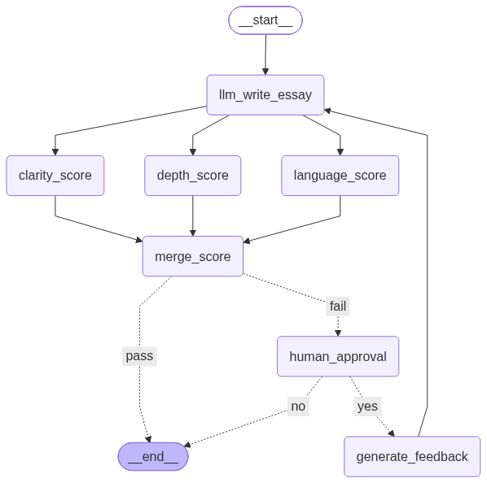

# 📝 LangGraph Essay Evaluation Workflow

<p align="center">
  
  
  
  
</p>

> A production-inspired Essay Evaluation Workflow built with **LangGraph**, showcasing parallel execution, conditional routing, Human-in-the-Loop approval, and iterative essay refinement.

---

# 📖 Overview

This project demonstrates how to orchestrate multiple LLM-powered tasks using **LangGraph**.

The workflow:

- ✍️ Generates an essay
- 📊 Evaluates the essay in parallel
- 🧮 Computes a final evaluation score
- 👨‍💻 Requests Human Approval if the score is below a threshold
- 💬 Generates improvement feedback
- 🔄 Rewrites the essay using the generated feedback
- ✅ Repeats until the essay passes or the user stops the workflow

---

# 🏗️ Workflow Graph

<p align="center">
    
</p>

---

# ⚡ Features

- 🚀 LangGraph StateGraph
- ⚡ Parallel Node Execution
- 🔀 Conditional Routing
- 👨‍💻 Human-in-the-Loop (HITL)
- 🧠 LLM-based Essay Generation
- 📊 Multi-Criteria Essay Evaluation
- 💬 AI-generated Feedback
- 🔁 Iterative Improvement Loop
- 📈 Production Workflow Design

---

# 🧠 Graph Nodes

| Node | Description |
|------|-------------|
| ✍️ Write Essay | Generates an essay from the given topic |
| 📖 Clarity Score | Evaluates clarity |
| 🧠 Depth Score | Evaluates content depth |
| 📝 Language Score | Evaluates grammar & writing quality |
| 📊 Merge Score | Computes final evaluation score |
| 👨‍💻 Human Approval | Requests approval for another iteration |
| 💬 Generate Feedback | Generates improvement suggestions |

---

# 🔀 Conditional Flow

```text
                Score
                  │
      ┌───────────┴───────────┐
      │                       │
      ▼                       ▼
    Pass                    Fail
      │                       │
      ▼                       ▼
     END             Human Approval
                           │
                 ┌─────────┴─────────┐
                 ▼                   ▼
               Retry               Stop
                 │                   │
                 ▼                   ▼
        Generate Feedback          END
                 │
                 ▼
           Rewrite Essay
```

---

# 🛠️ Tech Stack

- Python
- LangGraph
- LangChain
- OpenAI GPT-5 Nano
- TypedDict
- StateGraph

---

# 🚀 Getting Started

## Clone Repository

```bash
git clone https://github.com/<your-username>/langgraph-essay-evaluator.git
```

## Install Dependencies

```bash
pip install -r requirements.txt
```

## Configure Environment

```env
OPENAI_API_KEY=your_api_key
```

## Run

```bash
python main.py
```

---

# 📌 LangGraph Concepts Covered

- ✅ StateGraph
- ✅ Nodes
- ✅ Edges
- ✅ Parallel Execution (Fan-Out)
- ✅ Synchronization (Fan-In)
- ✅ Conditional Edges
- ✅ Human-in-the-Loop
- ✅ Workflow Loops
- ✅ State Management

